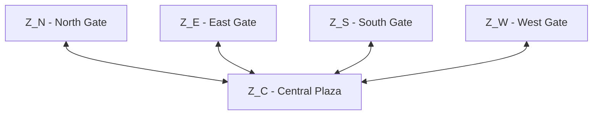
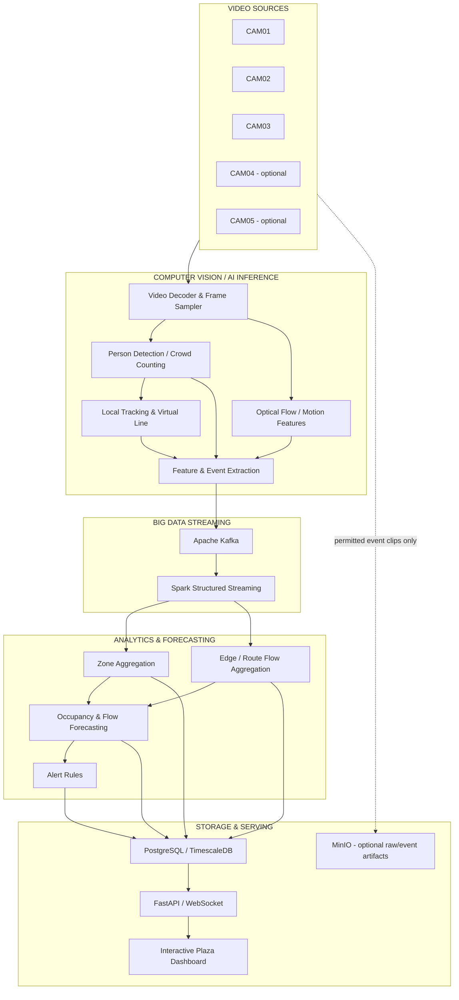

# PROJECT DESIGN & DATA STRATEGY

## Multi-Camera Plaza Crowd Flow Monitoring & Congestion Prediction System

**Môn học:** SE363 – Phát triển ứng dụng trên nền tảng dữ liệu lớn  
**Loại tài liệu:** Project Design & Data Specification  
**Phiên bản:** 1.0  
**Định hướng:** Plaza monitoring · Single-camera + Multi-camera · Hybrid data · Streaming AI analytics  
**Trạng thái:** Thiết kế đề xuất; các thông số và KPI phải được kiểm chứng bằng triển khai thực nghiệm.

---

## 1. Tổng quan dự án

### 1.1. Mô tả

Dự án xây dựng một nền tảng phân tích mật độ và luồng di chuyển của người đi bộ tại một quảng trường (public plaza). Hệ thống tiếp nhận video từ một hoặc nhiều camera, sử dụng Computer Vision để trích xuất thông tin về người và chuyển động, sau đó dùng Kafka và Spark Structured Streaming để tổng hợp dữ liệu theo camera, khu vực (zone) và đoạn đường kết nối (edge).

Từ dữ liệu lịch sử được tạo ra bởi pipeline, hệ thống thực hiện hai loại dự báo:

1. **Zone Occupancy Forecasting:** Ước lượng số người hoặc mức chiếm dụng tại từng zone trong 1, 3 hoặc 5 phút tiếp theo.
2. **Route / Edge Flow Forecasting:** Ước lượng lưu lượng người trên từng đoạn đường hoặc tuyến kết nối trong khoảng thời gian sắp tới.

Kết quả được hiển thị trên dashboard có sơ đồ mặt bằng quảng trường, vị trí camera, mật độ từng zone, hướng/lưu lượng di chuyển, dự báo và cảnh báo hỗ trợ nhân viên vận hành.

### 1.2. Bài toán thực tế

Người quản lý một quảng trường cần trả lời các câu hỏi:

- Hiện tại khu vực nào có nhiều người nhất?
- Lưu lượng người đi vào và đi ra tại từng lối đang thay đổi như thế nào?
- Những đoạn đường nào đang có lưu lượng tăng?
- Trong vài phút tới, zone nào có khả năng đông hơn?
- Đoạn đường nào có khả năng nhận thêm nhiều người?
- Có dấu hiệu ùn tắc cần nhân viên đến kiểm tra hay không?

Hệ thống là công cụ **giám sát và hỗ trợ ra quyết định**, không thay thế đánh giá của nhân viên hiện trường và không khẳng định có thể dự đoán chắc chắn sự cố nguy hiểm.

### 1.3. Định vị sản phẩm

**Multi-Camera Plaza Crowd Intelligence Platform** – nền tảng chuyển video camera thành dữ liệu vận hành có cấu trúc, hỗ trợ theo dõi và dự báo mật độ/lưu lượng người tại quảng trường.

Khách hàng giả định: đơn vị quản lý quảng trường, công viên, phố đi bộ, khuôn viên trường hoặc không gian công cộng.  
Người dùng trực tiếp: nhân viên vận hành, an ninh, quản lý cơ sở vật chất và bộ phận điều hành.

---

## 2. Mục tiêu, phạm vi và giới hạn

### 2.1. Mục tiêu chức năng

| Mã | Mục tiêu | Đầu ra |
|---|---|---|
| F01 | Nhận video từ file hoặc camera stream | Frame có timestamp và camera ID |
| F02 | Phát hiện/ước lượng số người | Detection hoặc crowd count |
| F03 | Phân tích chuyển động trong một camera | Track cục bộ, vận tốc, hướng |
| F04 | Đếm người đi qua lối có virtual line | Inflow / outflow theo edge |
| F05 | Tổng hợp dữ liệu từ nhiều camera | Zone occupancy và edge flow |
| F06 | Dự báo mức occupancy của zone | Occupancy forecast 1/3/5 phút |
| F07 | Dự báo lưu lượng edge/route | Edge/route flow forecast |
| F08 | Phát hiện xu hướng đông/ùn tắc | Alert có mức độ và bằng chứng |
| F09 | Trực quan hóa kết quả | Plaza map, camera view, heatmap, charts |
| F10 | Theo dõi pipeline Big Data | Throughput, latency, consumer lag, processing time |

### 2.2. Phạm vi MVP

MVP nên hoàn thành được một luồng end-to-end với số camera vừa sức:

- 1 địa điểm plaza được mô hình hóa bằng sơ đồ mặt bằng.
- Bắt đầu với 1 camera để hoàn thiện detection/tracking/counting.
- Mở rộng lên 3 camera đồng bộ để chứng minh multi-camera ở một topology nhỏ.
- Nếu dữ liệu và góc nhìn cho phép, mở rộng cấu hình lên 5 camera.
- Có ít nhất 2–3 zone và các edge được quan sát thực tế.
- Có dự báo baseline cho occupancy và edge flow.
- Có Kafka, Spark Structured Streaming, storage và dashboard.

**Không bắt buộc phải có 5 camera ngay từ đầu.** Số camera được quyết định bởi lối đi, vùng cần quan sát, góc nhìn, vật cản và khả năng thu thập. Phương án 5 camera trong tài liệu là topology tham chiếu cho quảng trường có bốn lối tiếp cận và một vùng trung tâm.

### 2.3. Ngoài phạm vi MVP

- Nhận diện danh tính hoặc khuôn mặt.
- Theo dõi danh tính một người xuyên nhiều camera.
- Dự đoán chính xác đường đi tương lai của từng cá nhân.
- Dựng mô hình 3D toàn bộ quảng trường.
- Phân tích phương tiện giao thông. Xe máy/ô tô không thuộc chỉ số crowd density người đi bộ; nếu mở rộng cần pipeline và metric riêng.
- Cam kết triển khai thực tế ở quy mô hàng trăm/hàng nghìn camera khi chưa benchmark.

---

## 3. Các bài toán AI và dữ liệu đầu ra

Dự án gồm ba lớp bài toán có liên hệ với nhau nhưng không dùng chung một loại nhãn.

### 3.1. Crowd Perception – Nhận biết và đếm người

Câu hỏi: **Trong frame hoặc vùng ảnh hiện có bao nhiêu người?**

Đầu vào: ảnh hoặc frame trích từ video.  
Đầu ra có thể là:

- Bounding boxes của người (nếu dùng object detection).
- Head points / density map (nếu dùng crowd counting).
- Estimated person count.
- Density theo vùng ảnh hoặc zone đã hiệu chuẩn.

### 3.2. Crowd Flow Analysis – Phân tích chuyển động

Câu hỏi: **Người đang di chuyển theo hướng nào và bao nhiêu lượt đi qua một lối?**

Đầu vào: chuỗi frame liên tiếp theo thứ tự thời gian.  
Đầu ra:

- Track ID cục bộ trong camera.
- Quỹ đạo trong vùng quan sát.
- Vận tốc và hướng chuyển động.
- Optical flow vectors.
- Sự kiện đi qua virtual line: IN/OUT.
- Lưu lượng trên từng edge theo cửa sổ thời gian.

### 3.3. Crowd Forecasting – Dự báo

Câu hỏi:

- Zone nào có thể đông hơn trong 1–5 phút tới?
- Edge/route nào có thể có lưu lượng tăng trong 1–5 phút tới?

Đầu vào: dữ liệu bảng/time-series được trích xuất từ video, gồm occupancy, inflow, outflow, speed, density và edge flow theo thời gian.  
Đầu ra:

- Predicted occupancy theo zone.
- Predicted flow theo edge/route.
- Xu hướng tăng/giảm.
- Cảnh báo theo ngưỡng cấu hình.

**Điểm cốt lõi:** mô hình dự báo thường được huấn luyện bằng dữ liệu time-series có nhãn mục tiêu, không phải lấy trực tiếp một bộ ảnh crowd counting để huấn luyện dự báo tương lai.

---

## 4. Phân biệt Image Dataset, Video Dataset và Time-series Dataset

Ba loại dữ liệu có vai trò khác nhau.

### 4.1. Image Dataset – Dữ liệu ảnh

Một ảnh là một quan sát tại một thời điểm. Ảnh phù hợp để học/đánh giá những thông tin không đòi hỏi quan sát chuyển động theo thời gian.

Dùng cho:

- Person detection.
- Crowd counting.
- Density estimation.
- Kiểm tra khả năng tổng quát hóa theo góc quay, mật độ và bối cảnh.

Ví dụ:

| Dataset | Annotation thường gặp | Vai trò |
|---|---|---|
| COCO | Bounding box, class | Pretrained/fine-tune person detector |
| ShanghaiTech Part A/B | Head points, count/density supervision | Crowd counting |
| JHU-CROWD++ | Point/count và thuộc tính cảnh | Crowd counting, đánh giá đa dạng bối cảnh |

Một ảnh đơn lẻ **không cho biết hướng di chuyển**. Tuy nhiên, frame được lấy từ video vẫn có thể được đưa vào model ảnh để dự đoán count/density tại thời điểm đó.

### 4.2. Video Dataset – Dữ liệu video

Video là chuỗi frame có thứ tự thời gian. Nó cung cấp thông tin cần thiết để phân tích chuyển động.

Dùng cho:

- Object tracking.
- Optical flow.
- Virtual line crossing.
- Inflow/outflow.
- Phân tích bất thường theo thời gian.
- Đánh giá hành vi trong một camera.
- Multi-camera analysis nếu nhiều video cùng địa điểm, cùng session và được đồng bộ thời gian.

Ví dụ dataset tham khảo:

| Dataset | Vai trò phù hợp | Giới hạn khi áp dụng |
|---|---|---|
| UCSD Pedestrian | Video người đi bộ, thử nghiệm anomaly detection | Không phải ground truth route cho plaza của nhóm |
| CUHK Avenue | Video anomaly detection | Nhãn bất thường không đồng nghĩa với panic/stampede |
| Video plaza do nhóm ghi | Tracking, line crossing, zone/edge flow | Cần tự xây ground truth và kiểm soát đồng bộ |

### 4.3. Time-series / Tabular Dataset – Dữ liệu chuỗi thời gian

Đây là dữ liệu được tạo ra sau khi chạy Computer Vision và tổng hợp video thành các chỉ số theo từng khoảng thời gian.

Ví dụ một bản ghi:

```json
{
  "timestamp": "2026-11-05T09:04:00Z",
  "site_id": "PLAZA_01",
  "zone_id": "Z_C",
  "current_occupancy": 110,
  "inflow_1m": 35,
  "outflow_1m": 25,
  "avg_speed_mps": 0.8,
  "density_persons_per_m2": 0.15,
  "target_occupancy_5m": 180
}
```

Các cột `current_occupancy`, `inflow_1m`, `outflow_1m`, `avg_speed_mps` là features; `target_occupancy_5m` là label cho bài toán dự báo 5 phút.

Time-series dataset dùng để train/evaluate:

- Zone occupancy forecasting.
- Edge flow forecasting.
- Route flow forecasting (khi có dữ liệu route được quan sát đáng tin cậy).

### 4.4. Quan hệ giữa ba loại dữ liệu

```text
IMAGE DATASET                     VIDEO DATASET
     |                                  |
     v                                  v
Detection / Crowd Counting       Tracking / Optical Flow
     |                                  |
     +---------------+------------------+
                     |
                     v
          Per-camera metrics/events
                     |
                     v
         Kafka + Spark aggregation
                     |
                     v
          Time-series / Tabular Data
                     |
                     v
       Occupancy & Flow Forecasting
                     |
                     v
            Dashboard & Alerts
```

Ảnh và video không phải hai nhánh tách rời. Video có thể được giải mã thành frame để dùng image model; thứ tự thời gian giữa các frame cho phép tracking và flow. Sau đó kết quả được biến thành dữ liệu bảng để forecasting.

---

## 5. Chiến lược dữ liệu HYBRID

Dự án sử dụng ba nguồn dữ liệu với mục đích tách biệt.

### 5.1. Source A – Public Datasets

Mục tiêu: tận dụng dữ liệu có sẵn để phát triển và đánh giá các mô hình Computer Vision nền tảng, đặc biệt là detection và crowd counting.

| Dataset | Loại | Nhãn/annotation | Mô hình/bài toán | Vai trò dự kiến |
|---|---|---|---|---|
| COCO | Ảnh | Bounding boxes và class | Person Detection | Dùng pretrained weights; có thể fine-tune nếu cần |
| ShanghaiTech | Ảnh | Head points / count supervision | CSRNet hoặc crowd counting model khác | Train/validation/test crowd counting |
| JHU-CROWD++ | Ảnh | Point/count và thuộc tính cảnh | Crowd counting | Bổ sung bối cảnh; đánh giá/fine-tune có kiểm soát |
| UCSD Pedestrian | Video | Nhãn phục vụ anomaly benchmark | Temporal anomaly analysis | Thử nghiệm bổ trợ |
| CUHK Avenue | Video | Nhãn bất thường theo đoạn/frame | Video anomaly detection | Thử nghiệm bổ trợ |

**Không nên gán sai mục đích dataset:**

- COCO bounding boxes có thể dùng cho person detection; không phải dataset crowd-counting density chuẩn.
- ShanghaiTech/JHU thường dùng head-point/count supervision; không tự động cung cấp bounding box của toàn thân từng người.
- UCSD/Avenue có nhãn anomaly theo benchmark; không thể dùng trực tiếp để khẳng định mô hình phát hiện panic, stampede hoặc route của plaza.
- Public datasets nhiều địa điểm giúp tăng tính đa dạng cho AI nền tảng, nhưng không thay thế video đa camera đồng bộ tại địa điểm demo.

### 5.2. Source B – Group-recorded Plaza Dataset

Mục tiêu: xây dựng dữ liệu thực nghiệm riêng cho bài toán multi-camera, zone occupancy, edge flow và forecasting.

Đặc điểm bắt buộc:

- Video được ghi tại cùng một địa điểm plaza đã mô hình hóa.
- Các camera ghi hình trong cùng session hoặc các khoảng thời gian chồng lấp có thể đồng bộ.
- Mỗi video có `site_id`, `session_id`, `camera_id` và timestamp.
- Có sơ đồ vị trí camera, vùng quan sát, zone và edge.
- Có annotation/ground truth cho các chỉ số dùng đánh giá.
- Có quyền ghi hình và xử lý phù hợp; hạn chế lưu video gốc không cần thiết.

Dữ liệu này dùng để:

1. Kiểm thử pretrained detector/tracker trên bối cảnh plaza.
2. Đo sai số line counting.
3. Xây dựng ground truth occupancy theo zone.
4. Xây dựng edge flow/route flow từ chuyển tiếp được quan sát.
5. Tạo time-series dataset cho occupancy/flow forecasting.
6. Đánh giá khả năng hoạt động trên địa điểm cụ thể của demo.

**Không nhất thiết tất cả public videos phải cùng địa điểm.** Yêu cầu cùng địa điểm và đồng bộ thời gian áp dụng cho nhóm video multi-camera dùng để hợp nhất luồng người tại một plaza.

### 5.3. Source C – Synthetic Data

Mục tiêu: kiểm thử hệ thống Big Data, không thay thế dữ liệu video thực để đánh giá AI.

Có thể tạo synthetic metadata cho các kịch bản:

- Số camera tăng từ 3 lên 5, 10 hoặc nhiều luồng giả lập hơn.
- Tốc độ metadata tăng/giảm.
- Inflow tăng nhanh, outflow thấp.
- Thiếu event, trễ event, event trùng lặp.
- Kafka consumer chậm hoặc Spark restart.
- Các zone/edge có lưu lượng khác nhau.

Synthetic data có thể dùng để stress test Kafka/Spark và kiểm tra tính đúng đắn của aggregation. Không dùng nó làm bằng chứng rằng AI nhìn video thực đã dự báo chính xác.

### 5.4. Phân biệt mục đích ba nguồn

| Nguồn | Có thể dùng để train AI? | Dùng cho đánh giá? | Vai trò chính |
|---|---|---|---|
| Public image datasets | Có, tùy nhãn | Có, theo split/benchmark | Detection/counting |
| Public video datasets | Tùy bài toán/nhãn | Có, theo benchmark | Tracking/anomaly thử nghiệm |
| Group plaza videos | Có thể fine-tune hoặc train forecasting sau khi gán nhãn | Rất quan trọng | Multi-camera/zone/edge/forecast |
| Synthetic metadata | Có thể thử thuật toán dự báo synthetic, nhưng không đại diện thực tế | Chỉ cho system testing | Kafka/Spark stress test |

---

## 6. Mô hình và thuật toán: dùng dữ liệu nào?

Không phải mọi module đều cần train một model riêng.

| Module | Cách triển khai đề xuất | Dữ liệu dùng | Có cần train? |
|---|---|---|---|
| Person Detection | YOLO hoặc detector pretrained | COCO/pretrained weights; bổ sung ảnh plaza bbox nếu fine-tune | Không bắt buộc train từ đầu |
| Crowd Counting | CSRNet/DM-Count hoặc model phù hợp | ShanghaiTech/JHU head points/count | Có nếu train/fine-tune model counting |
| Object Tracking | ByteTrack/BoT-SORT | Output detection trên video liên tiếp | Thường không cần train tracker riêng |
| Optical Flow | Farneback hoặc thuật toán flow khác | Frame liên tiếp | Không cần train |
| Virtual Line Counting | Quy tắc hình học + track local | Video plaza và ground truth crossing | Không nhất thiết train |
| Zone Occupancy | Detection/counting + ROI/zone calibration | Plaza video, zone annotations | Có thể không cần model riêng |
| Zone Forecasting | Baseline, EWMA, XGBoost/LightGBM | Time-series occupancy/inflow/outflow | ML model cần train; baseline không cần |
| Edge/Route Flow Forecasting | Moving average/EWMA rồi thử XGBoost/LightGBM | Time-series edge/route flow | ML model cần train khi đủ dữ liệu |
| Alert Engine | Rule engine theo ngưỡng/điều kiện | Occupancy, density, speed, forecast | Không nhất thiết train |

### 6.1. Person Detection

- Dùng detector pretrained để phát hiện `person` trong frame.
- Nếu detector hoạt động chưa tốt với góc nhìn plaza, thu thập và gán bounding box cho một tập ảnh đại diện để fine-tune hoặc đánh giá.
- Không dùng head-point annotation của ShanghaiTech như thể đó là bounding box toàn thân.

Output mẫu:

```json
{
  "camera_id": "CAM01",
  "frame_id": 1200,
  "timestamp": "2026-11-05T09:30:00Z",
  "detections": [
    {
      "class": "person",
      "bbox_xyxy": [100, 80, 150, 230],
      "confidence": 0.94
    }
  ]
}
```

### 6.2. Crowd Counting / Density Estimation

- Ảnh/frame là đầu vào.
- Dùng annotation head points/count của ShanghaiTech/JHU để train/fine-tune crowd-counting model.
- Model trả density map; tích phân/tổng các giá trị density map theo đúng quy ước model để ước lượng count.
- Dùng video plaza để đánh giá mức độ phù hợp trên bối cảnh demo.

Chỉ số cơ bản:

\[
MAE = \frac{1}{N}\sum_{i=1}^{N}|y_i-\hat y_i|
\]

\[
RMSE = \sqrt{\frac{1}{N}\sum_{i=1}^{N}(y_i-\hat y_i)^2}
\]

### 6.3. Object Tracking

- Dùng detection theo từng frame.
- Tracker liên kết detection giữa các frame để tạo `track_id` cục bộ.
- Track ID chỉ có ý nghĩa trong phạm vi một camera/session; không coi ID ở CAM01 và CAM05 là cùng một người.
- Không triển khai cross-camera identity tracking trong MVP.

### 6.4. Optical Flow

- Nhận hai frame liên tiếp.
- Tính vector chuyển động `(u, v)`.
- Tổng hợp hướng/tốc độ theo ROI/zone.
- Optical Flow mô tả chuyển động pixel tập thể; không tự động biết đích đến của từng người.
- Muốn so sánh vector giữa nhiều camera cần hiệu chuẩn tọa độ hoặc chuyển về hệ tọa độ mặt bằng phù hợp.

### 6.5. Virtual Line Counting

- Định nghĩa line tại lối đi.
- Dùng track cục bộ và vị trí đại diện của người (ví dụ bottom-center của bounding box) để kiểm tra crossing.
- Chỉ tạo event khi quỹ đạo vượt qua line theo quy tắc xác nhận; tránh đếm lặp nhiều frame.
- Hướng `IN/OUT` phải được định nghĩa theo topology.

### 6.6. Zone Occupancy Forecasting

Baseline bảo toàn dòng người:

\[
\widehat{N_z(t+H)} = N_z(t) + \widehat{Inflow_z(t,t+H)} - \widehat{Outflow_z(t,t+H)}
\]

Trong đó `H` là horizon dự báo, ví dụ 1, 3 hoặc 5 phút. Với zone có nhiều edge, inflow/outflow phải tổng hợp từ toàn bộ edge kết nối với zone.

Lộ trình mô hình:

1. Persistence: dự báo bằng giá trị gần nhất.
2. Moving Average/EWMA: baseline có làm mượt.
3. Conservation baseline: occupancy + inflow - outflow.
4. XGBoost/LightGBM: chỉ triển khai khi có đủ time-series và ground truth.

### 6.7. Edge / Route Flow Forecasting

- Ưu tiên dự báo lưu lượng trên từng edge vì đây là đại lượng có thể đo trực tiếp tại virtual line.
- Route nhiều edge chỉ được tạo khi có quan sát chuyển tiếp đủ tin cậy hoặc ground truth hợp lệ.
- Có thể sử dụng rolling features: flow trong 1/5/10 phút gần nhất, occupancy hai đầu edge, thời điểm trong ngày và xu hướng.
- Không suy ra chính xác origin-destination chỉ bằng cách so sánh tổng số người vào một cổng với tổng số người ra cổng khác.

---

## 7. Topology quảng trường và camera placement

### 7.1. Mô hình zone

Topology tham chiếu là quảng trường có bốn lối tiếp cận và một vùng trung tâm:

| Zone ID | Tên | Vai trò |
|---|---|---|
| Z_N | North Gate | Lối phía Bắc |
| Z_E | East Gate | Lối phía Đông |
| Z_S | South Gate | Lối phía Nam |
| Z_W | West Gate | Lối phía Tây |
| Z_C | Central Plaza | Vùng trung tâm |

Các edge vật lý tham chiếu:

- E_NC: Z_N ↔ Z_C
- E_EC: Z_E ↔ Z_C
- E_SC: Z_S ↔ Z_C
- E_WC: Z_W ↔ Z_C

### 7.2. Phương án 5 camera tham chiếu

| Camera | Vị trí dự kiến | Mục đích |
|---|---|---|
| CAM01 | Lối Bắc | Virtual line, inflow/outflow E_NC |
| CAM02 | Lối Đông | Virtual line, inflow/outflow E_EC |
| CAM03 | Lối Nam | Virtual line, inflow/outflow E_SC |
| CAM04 | Lối Tây | Virtual line, inflow/outflow E_WC |
| CAM05 | Vị trí cao quan sát trung tâm | Central occupancy, motion field và nhánh đường nhìn thấy được |

Đây là bố trí khái niệm. Vị trí thật phải được quyết định sau khi khảo sát mặt bằng, góc nhìn, độ phân giải, vật cản và khu vực được phép ghi hình.

CAM05 không mặc nhiên có thể quan sát toàn bộ bốn lối. Nếu góc nhìn không bao phủ các nhánh, hệ thống chỉ báo cáo motion/occupancy trong ROI quan sát được.

### 7.3. Phương án MVP 3 camera

Có thể bắt đầu với:

- CAM01 tại lối tiếp cận chính A.
- CAM02 tại lối tiếp cận chính B.
- CAM03 ở vị trí cao nhìn vùng trung tâm và phần giao nhau của các tuyến.

Khi đó graph phải thu gọn theo các vùng/edge thật sự được quan sát. Không được hiển thị các route chưa có dữ liệu hoặc không nằm trong phạm vi camera.

### 7.4. Quy tắc lựa chọn số camera

Số camera phụ thuộc:

- Số lối đi và giao lộ cần giám sát.
- Diện tích và hình dạng plaza.
- Góc nhìn, độ cao và độ phân giải camera.
- Vật cản và mức che khuất.
- Vị trí cần đặt virtual line.
- Chỉ số cần thu thập và độ chính xác yêu cầu.

Một camera có thể quan sát nhiều ROI; một vùng cũng có thể cần nhiều camera nếu bị che khuất. Không có quy tắc cố định “mỗi zone một camera”.

### 7.5. Zone Graph



Mỗi node là một zone; mỗi edge là lối đi có thể đi qua. Mỗi edge cần định nghĩa hướng, line counting, camera quan sát và quy tắc tổng hợp.

---

## 8. Data Collection Plan

### 8.1. Public data audit

Trước khi tải và gán nhãn, lập inventory cho từng dataset:

- Tên dataset, URL/nguồn, license/điều kiện sử dụng.
- Image hay video.
- Số file và định dạng.
- Annotation có sẵn: bbox, head point, count, track, anomaly label.
- Bài toán phù hợp.
- Split chính thức.
- Hạn chế và domain gap so với plaza.

Không tải hàng loạt trước khi xác định dataset phù hợp với bài toán.

### 8.2. Plaza video collection

Bắt đầu bằng 1–2 session thử nghiệm để kiểm tra camera placement và quy trình đồng bộ; chỉ mở rộng khi chất lượng đạt yêu cầu.

Mỗi session nên ghi nhận:

- Cùng một địa điểm.
- Các camera hoạt động cùng thời gian hoặc có khoảng ghi hình chồng lấp.
- Timestamp đồng bộ hoặc đủ thông tin để căn chỉnh.
- Camera ID, site ID, session ID.
- Vị trí camera và hướng nhìn.
- ROI/zone được quan sát.
- Vị trí và hướng virtual line.
- Thời tiết/ánh sáng nếu có liên quan.
- Ghi chú về vật cản, che khuất và chất lượng video.

Các tình huống ghi hình có thể gồm:

| Session | Kịch bản an toàn | Mục tiêu |
|---|---|---|
| S01 | Ít người qua lại | Baseline và vùng trống |
| S02 | Lưu lượng đi lại bình thường | Flow thông thường |
| S03 | Lưu lượng tăng ở lối A | Inflow tại edge A |
| S04 | Lưu lượng tăng ở lối B | Inflow tại edge B |
| S05 | Người đi theo nhiều hướng bình thường | Direction distribution |
| S06 | Mật độ khu trung tâm thay đổi | Occupancy trend |
| S07 | Các khung giờ khác nhau | Temporal variation |
| S08 | Điều kiện ánh sáng/góc nhìn khác | Robustness |

Không cần tạo tình huống nguy hiểm hoặc chen lấn. Chỉ thu thập hành vi đi bộ bình thường trong phạm vi được cho phép.

### 8.3. Đồng bộ thời gian

Mỗi frame/event cần có timestamp và camera ID. Với camera thật, ưu tiên đồng bộ đồng hồ bằng NTP và ghi nhận thời điểm thu frame. Với video quay sẵn, ghi mốc bắt đầu của từng file và căn chỉnh các session trước khi hợp nhất.

Ví dụ metadata:

```json
{
  "site_id": "PLAZA_01",
  "session_id": "S01",
  "camera_id": "CAM01",
  "frame_id": 1200,
  "timestamp": "2026-11-05T09:30:00.000Z",
  "source_type": "group_recorded"
}
```

### 8.4. Điều kiện chất lượng

- Video có đủ độ phân giải để nhận biết người ở vùng quan tâm.
- Không có quá nhiều rung/lóa/mất nét.
- Timestamp nhất quán.
- Vị trí camera và ROI được ghi lại.
- Góc nhìn có đủ độ phủ cho nhiệm vụ đã chọn.
- Không dùng frame từ camera khác địa điểm để giả lập một multi-camera session.

---

## 9. Annotation / Ground Truth Strategy

Không phải tất cả dữ liệu đều cần tự gán nhãn. Ưu tiên tận dụng annotation có sẵn của public dataset; chỉ bổ sung nhãn thiếu cho bài toán của nhóm.

### 9.1. Các loại nhãn

| Nhãn | Nội dung | Dùng cho |
|---|---|---|
| Bounding Box | Vị trí person trong ảnh/frame | Detection |
| Head Point / Count | Tọa độ đầu hoặc tổng số người | Crowd counting |
| Local Track ID | Mã track trong một camera | Tracking evaluation / line counting |
| Line Crossing | Thời gian, edge, IN/OUT | Inflow/outflow |
| Zone Occupancy | Số người trong zone tại timestamp | Occupancy evaluation/forecast target |
| Edge Flow | Lượt qua edge theo thời gian | Edge flow forecasting |
| Route Transition | Chuỗi zone chuyển tiếp được quan sát | Route analysis/forecasting |
| Congestion Label | Nhãn trạng thái theo tiêu chí định nghĩa | Alert evaluation |

### 9.2. Bounding boxes

Ví dụ:

```json
{
  "image": "CAM01_frame_001200.jpg",
  "objects": [
    {
      "class": "person",
      "bbox_xyxy": [100, 80, 150, 230]
    }
  ]
}
```

### 9.3. Head points / crowd count

Ví dụ:

```json
{
  "image": "shanghaitech_sample_001.jpg",
  "head_points": [[120, 80], [210, 95], [320, 130]],
  "person_count": 3
}
```

Đây là ví dụ giản lược. Cần giữ đúng annotation format và quy ước của dataset nguồn.

### 9.4. Line crossing

```json
{
  "site_id": "PLAZA_01",
  "session_id": "S01",
  "camera_id": "CAM01",
  "edge_id": "E_NC",
  "timestamp": "2026-11-05T09:30:05.200Z",
  "direction": "IN",
  "count": 1,
  "label_source": "manual_review"
}
```

### 9.5. Zone occupancy

```json
{
  "site_id": "PLAZA_01",
  "session_id": "S01",
  "timestamp": "2026-11-05T09:30:10Z",
  "zone_id": "Z_C",
  "ground_truth_occupancy": 42
}
```

### 9.6. Route transition

```json
{
  "site_id": "PLAZA_01",
  "session_id": "S01",
  "time_window_start": "2026-11-05T09:30:00Z",
  "time_window_end": "2026-11-05T09:35:00Z",
  "from_zone": "Z_N",
  "via_zone": "Z_C",
  "to_zone": "Z_E",
  "observed_count": 12,
  "label_source": "observed_local_trajectory"
}
```

Chỉ tạo nhãn route khi chuyển tiếp được quan sát hoặc có bằng chứng ground truth. Nếu chỉ có inflow/outflow tại hai cổng mà không quan sát được chuyển tiếp, chỉ lưu edge flow; không tạo nhãn origin-destination giả định.

### 9.7. Congestion labels

Định nghĩa trạng thái bằng tiêu chí đo được, ví dụ kết hợp:

- Occupancy hoặc density so với ngưỡng của zone.
- Inflow/outflow mất cân bằng.
- Tốc độ trung bình giảm trong khoảng thời gian đủ dài.
- Tình trạng lối đi và diện tích sử dụng.

Ngưỡng phải được hiệu chuẩn theo từng zone. Không dùng một con số người cố định cho tất cả khu vực. Nhãn nên được người gán nhãn kiểm tra và ghi rõ quy tắc.

### 9.8. Quy trình annotation

1. Chọn các clip/frame đại diện.
2. Xác định loại nhãn cần tạo.
3. Gán nhãn một phần nhỏ trước để thống nhất quy ước.
4. Kiểm tra chéo một phần annotation giữa các thành viên.
5. Sửa nhãn sai và lưu version.
6. Lưu file annotation cùng `site_id`, `session_id`, `camera_id` và timestamp.

Có thể dùng công cụ annotation video/ảnh như CVAT cho bounding box và tracking; các nhãn line crossing, zone occupancy và route có thể lưu CSV/JSON với quy trình kiểm tra riêng.

---

## 10. Tạo dữ liệu huấn luyện cho Forecasting

### 10.1. Từ video đến bảng time-series

Ví dụ pipeline tạo dữ liệu:

```text
Video frames
   |
   +--> Detector / Crowd Counter --> Count / Density
   |
   +--> Tracker / Virtual Line ----> IN / OUT events
   |
   +--> Optical Flow --------------> Speed / Direction features
                                      |
                                      v
                           Spark aggregation by time window
                                      |
                                      v
                          Zone / Edge time-series table
                                      |
                                      v
                         Attach future ground-truth target
                                      |
                                      v
                         Forecasting training dataset
```

### 10.2. Zone forecasting dataset

Mỗi dòng đại diện cho một zone tại một timestamp/window.

| Cột | Loại | Mô tả |
|---|---|---|
| timestamp | Feature/key | Thời điểm kết thúc cửa sổ |
| site_id | Key | Địa điểm |
| zone_id | Key | Khu vực |
| occupancy_t | Feature | Occupancy hiện tại |
| inflow_1m | Feature | Lượt đi vào trong 1 phút gần nhất |
| outflow_1m | Feature | Lượt đi ra trong 1 phút gần nhất |
| avg_speed_1m | Feature | Tốc độ trung bình |
| density_t | Feature | Mật độ hiện tại |
| occupancy_lag_1m | Feature | Occupancy ở thời điểm trước |
| occupancy_lag_5m | Feature | Occupancy 5 phút trước |
| hour_of_day | Feature | Giờ trong ngày |
| target_occupancy_5m | Label | Ground-truth occupancy sau 5 phút |

`target_occupancy_5m` phải được lấy từ ground truth hoặc nguồn đo đáng tin cậy tại thời điểm tương lai, không lấy dự báo của chính model làm nhãn thật.

### 10.3. Edge/route forecasting dataset

| Cột | Loại | Mô tả |
|---|---|---|
| timestamp | Feature/key | Thời điểm |
| edge_id / route_id | Key | Đoạn đường/tuyến |
| flow_1m | Feature | Lưu lượng 1 phút gần nhất |
| flow_5m | Feature | Lưu lượng 5 phút gần nhất |
| origin_occupancy | Feature | Occupancy zone đầu |
| destination_occupancy | Feature | Occupancy zone cuối |
| flow_lag_1m | Feature | Flow ở cửa sổ trước |
| flow_lag_5m | Feature | Flow 5 phút trước |
| target_flow_5m | Label | Flow ground truth trong 5 phút tương lai |

Với route nhiều edge, chỉ tạo dữ liệu nếu route đó được quan sát/định nghĩa rõ. Nếu chưa đủ dữ liệu, bắt đầu bằng edge-level flow forecasting.

### 10.4. Ví dụ tạo sample dự báo

Giả sử dữ liệu occupancy thực tế theo phút:

| Thời điểm | Occupancy thực tế |
|---|---:|
| 09:00 | 80 |
| 09:01 | 85 |
| 09:02 | 90 |
| 09:03 | 100 |
| 09:04 | 110 |
| 09:09 | 180 |

Tại thời điểm 09:04, model nhận feature lịch sử đến 09:04 và target là occupancy ground truth tại 09:09. Các sample sau được tạo tương tự bằng cách trượt cửa sổ theo thời gian.

### 10.5. Lượng dữ liệu cần thiết

Không nên đặt một con số cố định khi chưa biết tần suất ghi hình và độ biến động. Nguyên tắc:

- Có nhiều session ở các khung giờ khác nhau.
- Có ngày thường và ngày/khung giờ đông hơn nếu có thể.
- Có các mức lưu lượng khác nhau.
- Có đủ chuỗi liên tục dài hơn horizon dự báo.
- Có ground truth ở các thời điểm target.
- Kiểm tra số lượng sample và mức mất cân bằng trước khi chọn ML model.

Nếu dữ liệu chưa đủ, sử dụng baseline Persistence/Moving Average/EWMA và ghi rõ giới hạn; không cố train model phức tạp với ít sample.

---

## 11. Train / Validation / Test Strategy

### 11.1. Public datasets

- Ưu tiên giữ official split do dataset cung cấp.
- Không trộn annotation train/test.
- Ghi lại phiên bản dataset và cách tiền xử lý.
- Khi kết hợp hai dataset, lưu nguồn gốc từng sample.

### 11.2. Plaza video

Chia theo `session_id`, ngày quay hoặc site, không chia ngẫu nhiên từng frame liền kề.

Ví dụ minh họa:

| Split | Session |
|---|---|
| Train | S01–S05 |
| Validation | S06 |
| Test | S07–S08 |

Đây chỉ là ví dụ. Số session thực tế cần đủ và phân bố kịch bản hợp lý.

### 11.3. Generalization theo địa điểm

Nếu nhóm có video ở một plaza khác:

- Giữ riêng địa điểm đó làm external test nếu đủ dữ liệu.
- Đánh giá detector/counting và khả năng thích nghi với góc nhìn khác.
- Không đưa địa điểm external test vào train nếu muốn báo cáo kết quả generalization độc lập.

### 11.4. Forecasting time-series

- Chia theo thời gian hoặc session, giữ thứ tự thời gian.
- Chỉ dùng feature có sẵn tại thời điểm dự báo.
- Không để target tương lai lọt vào feature.
- Các cửa sổ input/target không được rò rỉ giữa train/test.
- Đánh giá riêng horizon 1, 3 và 5 phút.

---

## 12. Kiến trúc hệ thống

### 12.1. Logical architecture



### 12.2. Demo mode và deployment mode

**Demo mode:**

- Video file được phát lại theo timestamp để mô phỏng camera.
- Producer/decoder đọc frame.
- AI inference xử lý frame.
- Metadata/events được publish vào Kafka.
- Spark Structured Streaming tổng hợp dữ liệu.

**Deployment mode:**

- Camera CCTV cung cấp RTSP hoặc nguồn video được phép truy cập.
- Edge server chạy AI inference gần nguồn video.
- Metadata được gửi tới Kafka.
- Spark xử lý ở cụm streaming.

Không nhất thiết gửi mọi frame raw qua toàn bộ hệ thống production. Gửi metadata sau inference thường tiết kiệm băng thông và tài nguyên hơn. Trong demo, có thể có topic chứa frame để chứng minh ingestion, nhưng cần kiểm soát kích thước và tốc độ.

### 12.3. Kafka topics đề xuất

| Topic | Nội dung | Key đề xuất |
|---|---|---|
| `camera-metrics` | Count, density, speed, direction theo camera/window | `camera_id` |
| `zone-crossings` | Event IN/OUT qua virtual line | `edge_id` |
| `zone-state` | Occupancy và metrics theo zone | `zone_id` |
| `edge-flow` | Lưu lượng theo edge/time window | `edge_id` |
| `zone-forecasts` | Occupancy prediction | `zone_id` |
| `edge-forecasts` | Edge/route flow prediction | `edge_id`/`route_id` |
| `congestion-alerts` | Cảnh báo | `zone_id` |

`camera-frames` có thể được dùng trong demo nếu cần stream frame, nhưng không nên mặc định gửi video raw liên tục trong production.

### 12.4. Spark Structured Streaming

Nhiệm vụ:

1. Parse và validate metadata.
2. Xử lý event-time và dữ liệu đến muộn.
3. Aggregate theo camera, zone và edge.
4. Tính inflow/outflow/occupancy theo window.
5. Tạo feature cho forecasting.
6. Ghi kết quả vào storage/topic đầu ra.

Window, slide interval và watermark phải được benchmark. Watermark là cơ chế quản lý dữ liệu đến muộn, không phải độ trễ cảnh báo được bảo đảm.

### 12.5. Storage

- PostgreSQL: cấu hình site/camera/zone/edge, metadata vận hành, alerts.
- TimescaleDB (nếu dùng): time-series metrics và forecast history.
- MinIO (tùy chọn): video/ảnh sự kiện có mục đích lưu giữ hợp lệ, thời hạn và phân quyền rõ.

---

## 13. Dashboard Design

Dashboard hướng tới người quản lý plaza, không yêu cầu họ hiểu chi tiết Kafka/Spark.

### 13.1. Các trang chính

| Trang | Nội dung |
|---|---|
| Overview | Tổng số người ước lượng, mức mật độ, camera online, cảnh báo |
| Plaza Map | Sơ đồ mặt bằng, zone, edge, camera, directional arrows, heatmap |
| Camera Monitor | Video/frame từng camera và trạng thái AI |
| Zone Analytics | Occupancy, inflow/outflow, speed theo zone |
| Route Analytics | Edge flow và route flow được quan sát |
| Forecast | Dự báo occupancy/flow 1, 3, 5 phút |
| Alerts | Cảnh báo, thời điểm, lý do và zone liên quan |
| Historical Analytics | So sánh theo giờ/ngày/session |
| System Monitor | Kafka lag, Spark processing time, throughput, lỗi |

### 13.2. Bản đồ plaza

Dùng SVG hoặc ảnh mặt bằng làm nền. Overlay gồm:

- Polygon zone.
- Edge kết nối.
- Camera icon và hướng nhìn.
- Heatmap theo occupancy/density.
- Mũi tên theo hướng/lưu lượng quan sát.
- Màu cảnh báo hoặc xu hướng dự báo.

MVP nên dùng sơ đồ SVG/ảnh mặt bằng vì dễ kiểm soát tọa độ. Bản đồ địa lý có thể mở rộng sau nếu site có tọa độ thực.

### 13.3. Zone detail

Khi nhấn một zone, hiển thị:

- Current occupancy.
- Density và area được sử dụng để tính.
- Inflow/outflow.
- Average speed.
- Forecast 1/3/5 phút.
- Camera/ROI cung cấp dữ liệu.
- Lịch sử và confidence/quality indicator.

### 13.4. Route/edge detail

Khi nhấn một edge:

- Hướng và vị trí edge trên bản đồ.
- Flow hiện tại.
- Forecast flow.
- Lịch sử lưu lượng.
- Nguồn camera và phương pháp ghi nhận.
- Ghi chú nếu dữ liệu chỉ là edge flow chứ chưa đủ bằng chứng cho origin-destination route.

---

## 14. Alerting Logic

Alert engine nên bắt đầu bằng rule dễ kiểm chứng.

Ví dụ cảnh báo xu hướng occupancy:

```python
if (
    predicted_occupancy > zone_capacity_threshold
    and inflow_rate > outflow_rate
):
    alert = "PREDICTED_HIGH_OCCUPANCY"
```

Ví dụ cảnh báo ùn tắc cần kết hợp thêm vận tốc/density:

```python
if (
    density > zone_density_threshold
    and avg_speed < zone_speed_threshold
    and condition_persists_for_required_windows
):
    alert = "POSSIBLE_CONGESTION"
```

Ngưỡng được cấu hình theo zone và phải hiệu chuẩn từ mặt bằng, diện tích sử dụng, dữ liệu thực nghiệm và yêu cầu vận hành. Cảnh báo là tín hiệu hỗ trợ nhân viên xác minh, không phải kết luận an toàn tuyệt đối.

---

## 15. Evaluation Plan

### 15.1. Computer Vision

| Module | Metric đề xuất |
|---|---|
| Person Detection | Precision, Recall, mAP |
| Crowd Counting | MAE, RMSE |
| Tracking | IDF1/HOTA nếu có ground truth phù hợp |
| Line Counting | Count MAE, precision/recall cho crossing events |
| Optical Flow | Sai số hướng/flow trên vùng có ground truth; hoặc đánh giá định tính nếu không có ground truth chuẩn |

### 15.2. Zone / Route Forecasting

| Bài toán | Metric |
|---|---|
| Zone occupancy forecast | MAE, RMSE |
| Edge flow forecast | MAE, RMSE hoặc WAPE |
| Route flow forecast | MAE/WAPE; Top-k route accuracy nếu có nhãn route |
| Congestion alerts | Precision, Recall, F1 |

Đánh giá riêng horizon 1, 3 và 5 phút. Luôn so sánh ML model với baseline Persistence/Moving Average/EWMA.

### 15.3. Big Data System

| Metric | Cách đo |
|---|---|
| Throughput | Video FPS hoặc metadata events/sec |
| End-to-end latency | Từ timestamp/frame ingestion đến kết quả hiển thị |
| Spark processing time | Batch/query execution time |
| Kafka consumer lag | Số message consumer chưa xử lý |
| Recovery | Restart consumer/Spark và kiểm tra checkpoint |
| Scalability | Tăng luồng synthetic metadata, đo tài nguyên và throughput |

Không báo cáo mục tiêu throughput/latency như kết quả thực tế trước khi đo. Nếu stress test dùng synthetic metadata, ghi rõ đó là kết quả kiểm thử hạ tầng chứ không phải độ chính xác AI.

---

## 16. Tổ chức thư mục dữ liệu và source code

### 16.1. Data directory

```text
data/
├── public/
│   ├── coco/
│   ├── shanghaitech/
│   ├── jhu_crowdpp/
│   ├── ucsd_pedestrian/
│   └── avenue/
│
├── own_data/
│   └── plaza_01/
│       ├── session_001/
│       │   ├── raw/
│       │   │   ├── cam01.mp4
│       │   │   ├── cam02.mp4
│       │   │   ├── cam03.mp4
│       │   │   ├── cam04.mp4        # optional
│       │   │   └── cam05.mp4        # optional
│       │   ├── annotations/
│       │   │   ├── detections.json
│       │   │   ├── line_crossings.csv
│       │   │   ├── zone_occupancy.csv
│       │   │   └── edge_flow.csv
│       │   └── session_metadata.json
│       └── session_002/
│
├── synthetic/
│   ├── normal_flow/
│   ├── high_inflow/
│   ├── late_events/
│   └── stress_test/
│
├── processed/
│   ├── frames/
│   ├── detections/
│   ├── tracking/
│   └── features/
│
├── forecasting/
│   ├── zone_timeseries/
│   └── edge_timeseries/
│
└── manifests/
    ├── dataset_inventory.csv
    ├── session_manifest.csv
    ├── split_manifest.csv
    └── annotation_schema.json
```

### 16.2. Source code structure

```text
plaza-crowd-intelligence/
├── configs/
│   ├── site.yaml
│   ├── cameras.yaml
│   ├── zones.yaml
│   ├── edges.yaml
│   └── thresholds.yaml
├── ingestion/
│   ├── video_reader.py
│   ├── frame_sampler.py
│   └── video_producer.py
├── ai/
│   ├── detection/
│   ├── crowd_counting/
│   ├── tracking/
│   ├── optical_flow/
│   ├── line_counting/
│   └── inference_service.py
├── kafka/
│   ├── producers/
│   ├── consumers/
│   └── schemas/
├── streaming/
│   ├── camera_metrics.py
│   ├── zone_aggregation.py
│   ├── edge_flow_aggregation.py
│   └── streaming_job.py
├── forecasting/
│   ├── occupancy_baseline.py
│   ├── occupancy_model.py
│   ├── edge_flow_model.py
│   └── evaluation.py
├── storage/
├── backend/
├── dashboard/
├── evaluation/
├── tests/
├── docker-compose.yml
└── README.md
```

---

## 17. Lộ trình triển khai đề xuất

| Phase | Công việc | Deliverable |
|---|---|---|
| P1 – Data Audit | Chốt bài toán, kiểm tra public dataset, lập inventory, định nghĩa plaza topology | Dataset inventory + topology draft |
| P2 – Single-camera prototype | Chạy pretrained detector, tracking, optical flow và line counting trên một video | Một camera tạo metadata có kiểm tra |
| P3 – Public CV experiments | Train/evaluate crowd counting trên dataset phù hợp; so sánh với pretrained detector | Notebook + metrics AI |
| P4 – Plaza Data Collection | Ghi video đồng bộ, lập annotation và ground truth | Plaza sessions + annotations |
| P5 – Multi-camera aggregation | Zone/edge graph, hợp nhất metrics và kiểm tra count conservation | Zone/edge time-series |
| P6 – Streaming | Kafka + Spark Structured Streaming + storage/checkpoint | Pipeline streaming end-to-end |
| P7 – Forecasting | Baseline occupancy/edge flow, sau đó thử ML nếu đủ dữ liệu | Forecast models + metrics |
| P8 – Dashboard | Plaza map, camera, heatmap, flow, forecast, alert | Giao diện demo |
| P9 – Evaluation | AI/forecast/system benchmark, failure tests, report | Báo cáo thực nghiệm |

**Thứ tự ưu tiên:** đừng mở rộng nhiều camera trước khi một camera tạo được metadata đúng; đừng train forecasting trước khi có time-series và target ground truth; đừng stress test synthetic rồi dùng kết quả đó thay cho đánh giá AI trên video thật.

---

## 18. Đối chiếu yêu cầu SE363

| Yêu cầu học phần | Thiết kế đáp ứng | Bằng chứng nhóm cần tạo |
|---|---|---|
| Bài toán có ứng dụng thực tế | Plaza monitoring và hỗ trợ quản lý mật độ/luồng người | Use case, topology, người dùng và kịch bản demo |
| Dữ liệu đa dạng (variety) | Image, video, event metadata, time-series, synthetic metadata | Dataset inventory và schema |
| Volume | Lưu lịch sử time-series; nhiều camera/session; stress test | Dung lượng, throughput và benchmark |
| Velocity | Video/frame ingestion và metadata streaming | Kafka metrics, latency, consumer lag |
| AI tích hợp pipeline | Detection/counting/tracking/flow và forecasting | AI inference kết nối Kafka/Spark |
| Kafka | Tiếp nhận và phân phối camera metrics/events | Topic, partition, producer/consumer demo |
| Spark Structured Streaming | Window aggregation, zone/edge analytics | Streaming query, checkpoint, processing metrics |
| Storage | Lưu metrics, forecast và alert | Database schema và truy vấn lịch sử |
| Serving/UI | Bản đồ plaza và dashboard | Demo tương tác end-to-end |
| Scalability | Mở rộng camera và synthetic load test | Benchmark có cấu hình và giới hạn rõ |
| Evaluation | AI, forecasting và system metrics | Test set, ground truth, báo cáo kết quả |

Bảng này mô tả cách thiết kế hướng tới tiêu chí SE363. Chỉ được đánh dấu hoàn thành sau khi có code, demo và kết quả thực nghiệm.

---

## 19. Quy tắc kỹ thuật và rủi ro cần nhớ

1. **Ảnh đơn lẻ không cho biết hướng đi.** Muốn phân tích hướng cần video/frame liên tiếp hoặc dữ liệu chuyển động.
2. **Video không tự động là dữ liệu train.** Cần xác định task và annotation tương ứng; một số thuật toán như Farneback không cần train.
3. **Public image datasets không thay thế plaza multi-camera data.** Chúng chủ yếu hỗ trợ detection/counting; plaza cần video đồng bộ và topology riêng.
4. **Forecasting cần time-series có target.** Dữ liệu count/flow hiện tại chưa đủ; phải ghép với occupancy/flow thực tế ở thời điểm tương lai để tạo label.
5. **Không đồng nhất edge flow với origin-destination route.** Đếm tại hai cổng không chứng minh cùng những người đó đã đi qua một tuyến cụ thể.
6. **Track ID không phải danh tính.** ID của tracker thường chỉ cục bộ trong camera; không ghép ID xuyên camera trong MVP.
7. **Không cộng count mù quáng giữa các camera.** Vùng nhìn chồng lấn có thể làm đếm trùng; cần ROI, ownership hoặc cơ chế hợp nhất phù hợp.
8. **Density cần diện tích/ROI đã hiệu chuẩn.** Số người trên ảnh không thể chia cho diện tích thực tùy ý.
9. **Synthetic data chỉ kiểm tra hệ thống.** Không dùng làm bằng chứng chất lượng AI trên video thực.
10. **Dữ liệu phải có quyền sử dụng.** Ghi hình ở không gian công cộng cần tuân thủ yêu cầu cho phép, thông báo và bảo vệ dữ liệu phù hợp; không nhận diện danh tính, giới hạn quyền truy cập và thời gian lưu video gốc.
11. **Ngưỡng cảnh báo theo từng zone.** Không dùng một ngưỡng người hoặc tốc độ cho mọi địa điểm.
12. **Kết quả dự báo là ước lượng.** Dashboard nên hiển thị horizon, độ tin cậy/giới hạn và nguồn dữ liệu; nhân viên có trách nhiệm xác minh cảnh báo.

---

## 20. Kết luận

Dự án không phải một mô hình AI duy nhất được train bằng một dataset duy nhất. Đây là một hệ thống nhiều tầng:

- **Public image datasets** giúp phát triển/đánh giá person detection và crowd counting.
- **Public video datasets** hỗ trợ thử nghiệm các bài toán chuyển động hoặc anomaly phù hợp với annotation có sẵn.
- **Plaza videos do nhóm ghi** cung cấp dữ liệu đồng bộ để kiểm thử multi-camera, virtual line, zone và edge flow.
- **Time-series dataset được tạo từ video và ground truth** là dữ liệu chính để train/evaluate occupancy và flow forecasting.
- **Synthetic metadata** dùng để stress test Kafka/Spark và khả năng mở rộng, không thay thế video thật.

Pipeline mục tiêu:

```text
Public image/video + Plaza synchronized videos
                    |
                    v
      Computer Vision / AI Inference
                    |
                    v
     Count · Density · Tracking · Flow
                    |
                    v
       Kafka + Spark Structured Streaming
                    |
                    v
      Zone / Edge / Route Time-series
                    |
                    v
       Occupancy & Flow Forecasting
                    |
                    v
        Alerts + Interactive Plaza Map
```

Thứ tự thực hiện hợp lý nhất là: **Data Audit → Single-camera prototype → Plaza data collection/annotation → Multi-camera aggregation → Time-series creation → Forecasting → Kafka/Spark integration → Dashboard → Benchmark.**

Đây là thiết kế nền tảng; các lựa chọn mô hình, số camera và KPI cuối cùng cần được điều chỉnh theo dữ liệu thực tế mà nhóm thu thập được.
